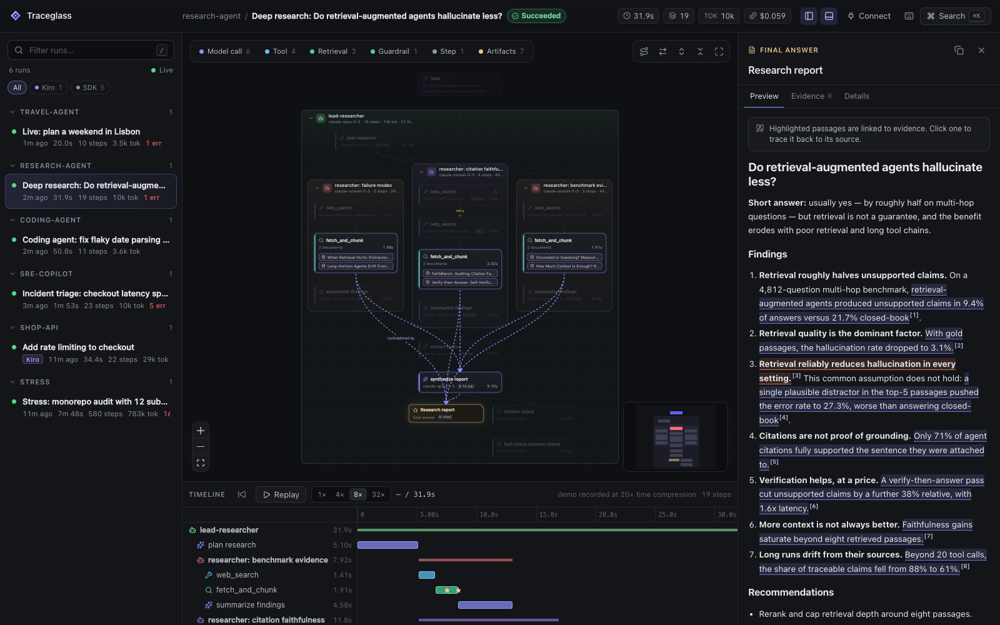
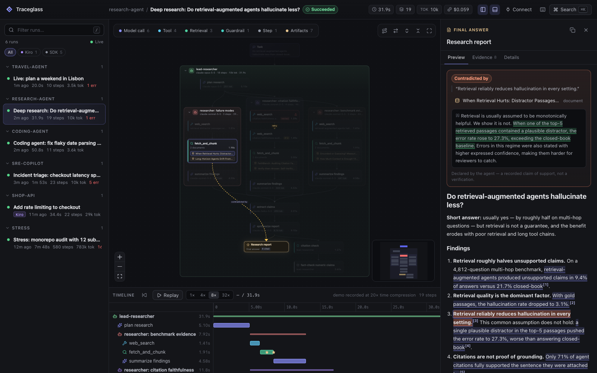
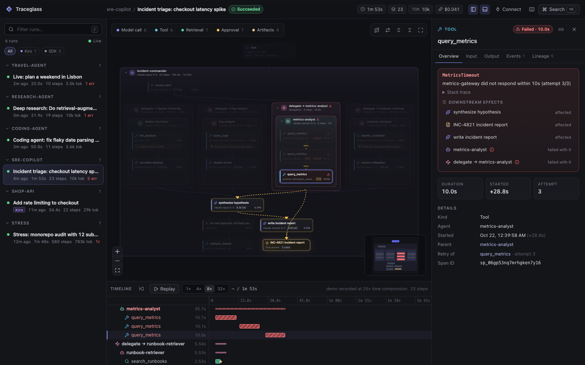
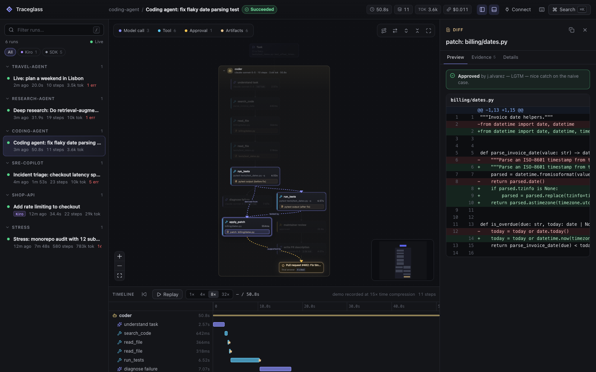
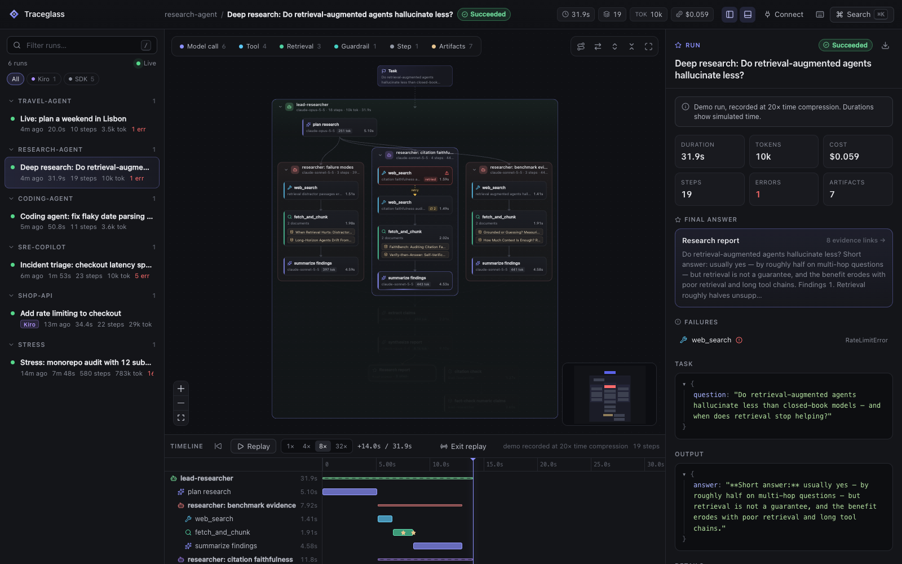
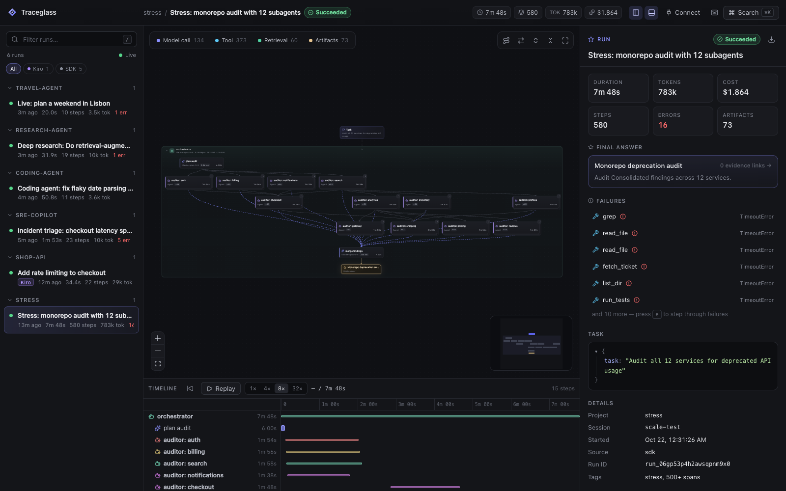
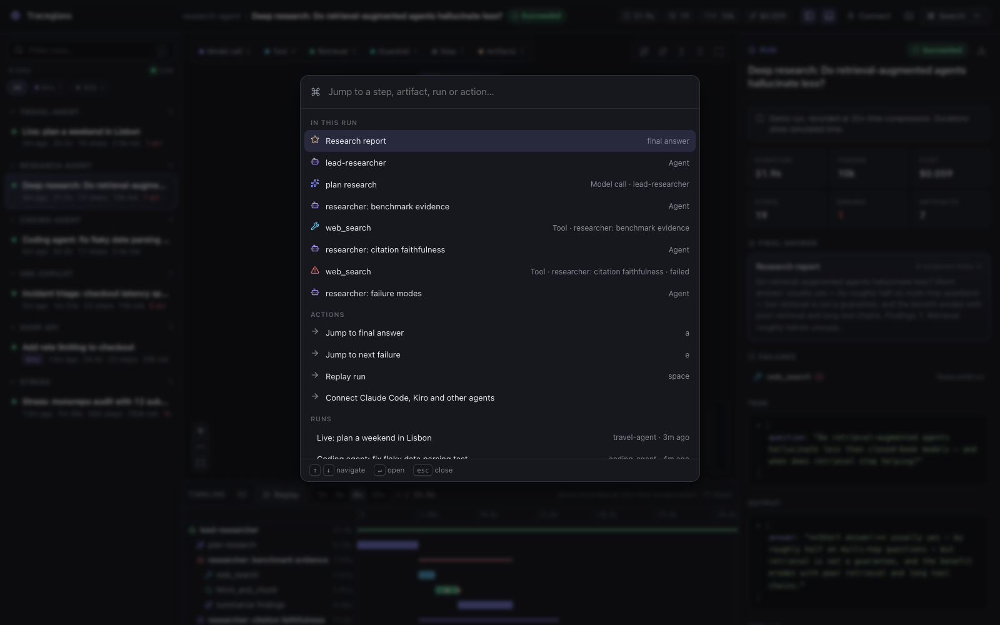
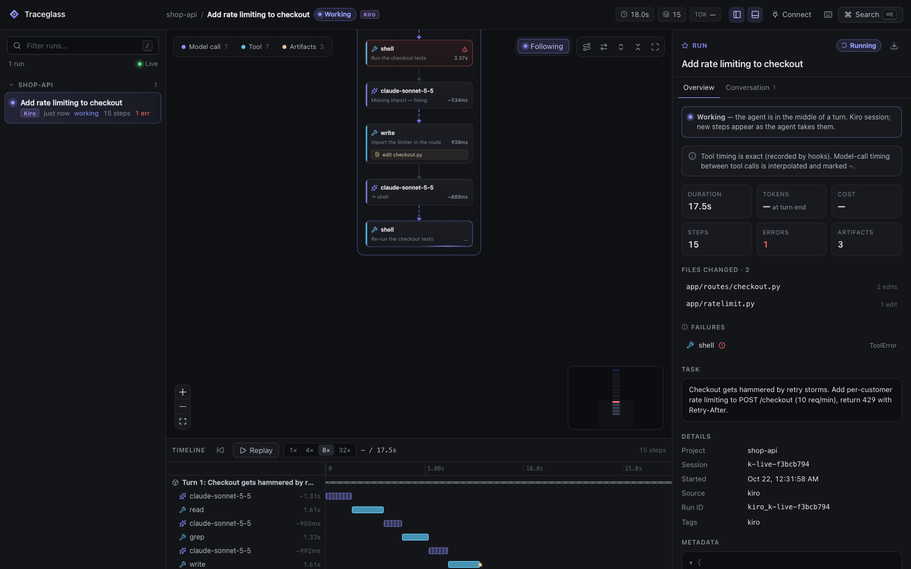
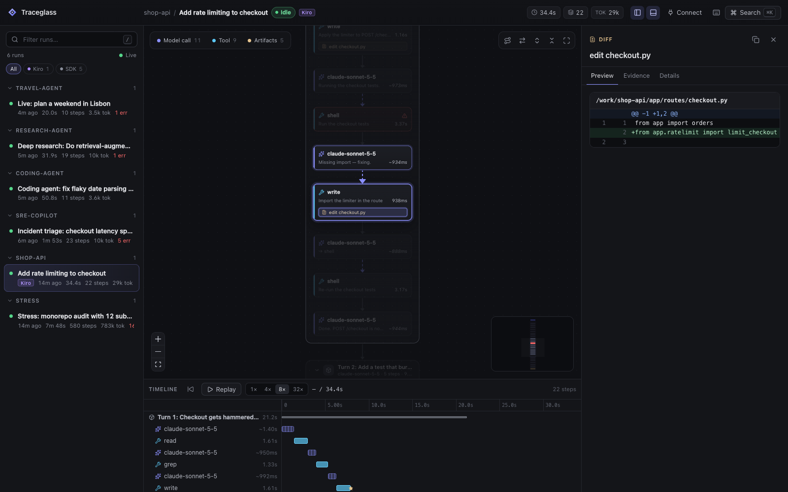

<div align="center">


# Traceglass

**See how your agent arrived at its answer.**

A local-first, framework-agnostic visualization layer that turns any agent run into a navigable,<br/>
reviewable record — execution graph, timeline, replay, and evidence you can click through.

[Quick start](#quick-start) · [What you get](#what-you-get) · [Coding agents](#your-coding-agents-live) · [Integrations](#integrations) · [Demos](#the-demos) · [Design](docs/SPEC.md) · [Schema](docs/schema.md)

</div>



> Agent observability tells you **what ran**. Traceglass helps you **understand, navigate and review what happened** — and answer the question that matters when you review AI-generated work: *where did this come from?*

## Quick start

```bash
pip install -e python            # zero runtime dependencies (Python ≥ 3.9)
traceglass demo                  # records five showcase runs, starts the UI, opens your browser
```

Instrument your own agent in a few lines:

```python
import traceglass as tg

@tg.tool
def search(query: str) -> list[str]:
    return corpus.search(query)

with tg.run("Compare papers", project="research-agent", input={"question": q}):
    with tg.agent("researcher"):
        hits = search(q)                                   # → a tool span, args + result captured
        doc = tg.artifact("Paper A §3", hits[0], kind="document")
        with tg.llm("synthesize", model="claude-opus-5-5") as call:
            call.usage(input_tokens=1840, output_tokens=412).uses(doc)
            report = tg.artifact("Report", text, kind="markdown", final=True)
            report.cite(doc, anchor="RAG halves unsupported claims",   # passage in the report
                             quote="9.4% of answers, compared with 21.7%")  # passage in the source
```

```bash
traceglass serve --open          # http://127.0.0.1:7357 — runs appear live while they execute
```

Already using a coding agent? Point Traceglass at it — no code changes:

```bash
traceglass serve --watch --open  # every Claude Code and Kiro session on this machine, live
```

Records go to a local SQLite file (`~/.traceglass/traceglass.db`). The agent never talks to the server; the server tails the database, so **live view works across processes with zero configuration**.

## What you get

| | |
|---|---|
| **Semantic execution graph** | Agents become containers, steps flow in time, parallel branches fork and join, retries and data dependencies get their own edges. Model calls, tools, retrieval, delegation, approvals and guardrails each have a distinct visual identity. |
| **Provenance, not just traces** | Select any output and its upstream path lights up — through the producing step, the documents it used, and the retrieval that found them. Click a highlighted claim in a report to see the exact source passage behind it, including evidence that *contradicts* it. |
| **Failures with consequences** | A failed tool call shows its error, its retry history, which enclosing steps failed with it, and what downstream work it affected. |
| **Replay** | Scrub or play the run back at 1–32×; the graph shows what was running at every instant. Deep links capture the moment (`#/run/<id>/<node>?t=14000`). |
| **Navigable history** | Runs grouped by project and session, stable deep links to any run, step or artifact, a ⌘K palette across every run, full keyboard navigation (`j/k/h/l`, `e` next failure, `a` final answer, `?` for all). |
| **Rich artifacts** | Markdown with evidence highlights, unified diffs, code, JSON, retrieved passages, human review status. |
| **Honest by construction** | *Not captured*, *redacted*, *truncated* and *empty* are four different things and the UI says which. Secrets are redacted before they leave the process. Evidence links are labelled as declared, not verified. |
| **Shareable** | `traceglass export <run> -o run.html` writes one self-contained HTML file — attach it to a PR or incident; it opens offline. `--site` builds a static site for GitHub Pages. |
| **Legible at scale** | 500+ step runs open with heavy subtrees collapsed, kind filters, and search — not a hairball. |

<table>
<tr>
<td width="50%"><br/><sub><b>Evidence.</b> A claim the agent made, the passage it cited — and here, a source that contradicts it.</sub></td>
<td width="50%"><br/><sub><b>Failures.</b> Three timed-out attempts, the subagent and delegation that failed with them, and the report written on degraded evidence.</sub></td>
</tr>
<tr>
<td><br/><sub><b>Artifacts.</b> A coding agent's patch, tested-by links to the test runs, and the maintainer's approval.</sub></td>
<td><br/><sub><b>Replay.</b> The run as it stood 14 seconds in: what had finished, what was running, what hadn't started.</sub></td>
</tr>
<tr>
<td><br/><sub><b>Scale.</b> 580 steps, 12 subagents, collapsed by default and still readable.</sub></td>
<td><br/><sub><b>Navigation.</b> Jump to any step, artifact, run or action.</sub></td>
</tr>
</table>

## Your coding agents, live

Traceglass reads **Claude Code** and **Kiro CLI** sessions straight from disk — running ones stream in as the agent works, closed ones become reviewable records. Optional lifecycle hooks add exact per-step timing.



- **Live now.** Sessions an agent is working in pin to the top; the canvas follows the newest step until you take over.
- **Files changed.** Every file the agent wrote, one click from its diff — and from there back to the tool call, the model call that asked for it, and your prompt.
- **Conversation.** The session as a transcript where every line jumps to its node.
- **Long sessions stay legible.** Earlier turns fold; 300-step turns page into *Steps 1–20, 21–40…* with per-page counts of tools, failures and edits.
- **Honest timing.** Claude Code timestamps every step; Kiro timestamps turns, so in-turn steps are marked `~estimated` until you install hooks.



```bash
traceglass watch                                  # or: traceglass serve --watch
traceglass hooks install claude-code --dry-run    # optional exact timing; shows the settings diff first
traceglass hooks install kiro --dry-run
traceglass import claude-code --all               # backfill; also: traceglass import kiro --all
```

Hooks record timing metadata only (never prompt or tool content), run asynchronously, print nothing, and uninstall restores your settings byte-for-byte. Details: [docs/coding-agents.md](docs/coding-agents.md).

## Integrations

The core does not depend on any framework, and your agent does not depend on the UI. Every integration is a thin translator onto the same [canonical model](docs/schema.md).

| Source | How | |
|---|---|---|
| **Any Python agent** | `tg.run`, `tg.span`, `@tg.tool` / `@tg.llm` / `@tg.agent` / `@tg.retrieval`, `tg.artifact`, `.cite()` | sync, async, threads (`tg.ThreadPoolExecutor`) |
| **LangChain / LangGraph** | `with tg.observe(project=...): graph.invoke(...)` — or pass `TraceglassCallbackHandler()` | automatic, no rewrite |
| **Anthropic SDK** | `client = instrument(Anthropic())` | model, messages, tool use, cache tokens |
| **OpenTelemetry** | point an OTLP/HTTP **JSON** exporter at `/v1/traces` | GenAI `gen_ai.*` + OpenInference conventions |
| **Claude Code** | `traceglass watch` · `traceglass import claude-code` · `traceglass hooks install claude-code` | live and closed sessions, turns, tool calls, subagents, file edits as diffs |
| **Kiro CLI** | `traceglass watch` · `traceglass import kiro` · `traceglass hooks install kiro` | live and closed sessions, each tool call's stated purpose, subagent sessions grouped with their parent |
| **TypeScript / Node** | [`sdk/typescript`](sdk/typescript) | same wire format |
| **Anything else** | `POST /api/ingest {"records": [...]}` | [schema](docs/schema.md) |

Details and snippets: [docs/integrations.md](docs/integrations.md).

## The demos

`traceglass demo` records deterministic, offline runs designed to exercise every feature. No API keys are needed. Their code is meant to be read as examples of the SDK: [`python/src/traceglass/demos`](python/src/traceglass/demos).

| Demo | Shows |
|---|---|
| `research` — *Do retrieval-augmented agents hallucinate less?* | 3 parallel research subagents, a 429 retried with backoff, retrieved passages as documents, a report whose every claim cites an exact quote (one is contradicted), a citation guardrail |
| `coding` — *Fix a flaky date-parsing test* | file reads, a failing then passing test run, a unified-diff patch `tested_by` both runs, a human approval gate, a PR description citing its evidence |
| `incident` — *Checkout latency spike* | an orchestrator delegating to four specialists in parallel, one failing permanently after 3 attempts, synthesis on degraded evidence, an on-call approval |
| `live` | a real-time run (~25s) — watch nodes appear |
| `stress` | 580 steps / 12 subagents — legibility at scale |
| `claude` *(opt-in)* | a real tool-using Claude agent instrumented with `instrument(client)`; needs `ANTHROPIC_API_KEY` |

Demo runs are recorded with a compressed clock so a 90-second run takes a few seconds; the UI says so.

## Honest by design

A trace records what the instrumentation **observed**: inputs, outputs, tool calls, timing, and the evidence the agent **declared**. It does not expose a model's private reasoning, and a tidy provenance graph is not proof that an answer is correct. Traceglass keeps those lines visible:

- **Absent ≠ not captured ≠ empty.** A field the framework never reported is shown as absent; a value that existed but wasn't recorded carries a `not_captured` marker with a reason; `null` means null.
- **Redaction by default.** Secret-looking keys (`api_key`, `authorization`, `password`, …) and values (`sk-…`, `AKIA…`, bearer tokens, private keys) are replaced before records leave the process. Configure with `tg.configure(redact=Redactor(keys=[...]))`.
- **Evidence is declared.** Links say who declared them (`agent`, `framework`, `human`). Review decisions (`artifact.review("approved", by=...)`) are recorded separately from the model's claims.
- **Compressed time is labelled.** Demo runs carry `metadata.time_scale` and the UI shows it.

## Architecture

```
 your agent ─┬─ Python SDK ──────────┐
             ├─ LangChain / LangGraph├──▶ canonical records ──▶ SQLite (local, WAL)
             ├─ Anthropic SDK        │    runs · spans · events     ▲      │ change log
             ├─ OTLP JSON  ─────┐    │    artifacts · links         │      ▼
             ├─ Claude Code ────┤    │                         POST /api/ingest   SSE /api/stream
             └─ TypeScript SDK ─┴────┘                              traceglass serve ──▶ UI
```

- **Core:** stdlib-only Python — recorder, SQLite store, HTTP + server-sent-events server, CLI.
- **UI:** React + TypeScript, React Flow for the canvas, ELK for hierarchical layout, built into the Python package so `pip install` ships it.
- **Security:** the server binds to loopback only (use an SSH tunnel for remote viewing), rejects non-loopback `Host` headers (DNS rebinding), requires same-origin JSON for writes, sends no CORS headers, and serves the UI under a strict CSP.

## Development

```bash
python3 -m venv .venv && .venv/bin/pip install -e 'python[dev]'
.venv/bin/python -m pytest python/tests -q          # Python suite

cd ui && npm install
npm run dev                                         # Vite on :5173, proxies /api to :7357
npm run build                                       # writes the bundle into the Python package
npx vitest run                                      # UI model tests
```

```
python/src/traceglass/   recorder · capture · store · server · otlp · export · watch · hooks · cli
                         integrations/  langchain · anthropic · claude_code · kiro · sessions
                         demos/         research · coding · incident · live · stress · claude
ui/src/                  model/ (graph, lineage, layout) · components/ (canvas, timeline, inspector…)
sdk/typescript/          @traceglass/sdk
schema/                  traceglass.schema.json (v1)
docs/                    SPEC.md · schema.md · integrations.md
```

## Roadmap

- OTLP protobuf ingestion and an OpenTelemetry span exporter for the SDK
- OpenAI Agents SDK and LlamaIndex adapters; Kiro IDE (as opposed to CLI) sessions
- Run comparison (diff two runs of the same task) and evaluation overlays
- Semantic search across run history
- Pluggable storage backends for team deployments

## License

[Apache-2.0](LICENSE)
