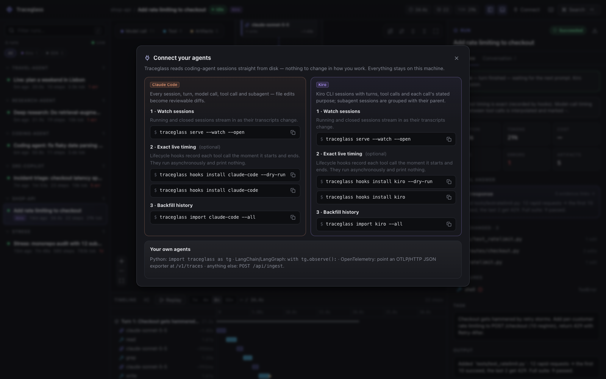

# Coding agents: Claude Code and Kiro

Traceglass reads coding-agent sessions straight from disk. Nothing changes in how you work: running sessions stream in as the agent works, and closed sessions become reviewable records — every turn, model call, tool call, subagent and file edit, one click from the change it produced.

```bash
traceglass serve --watch --open        # UI + live watcher for Claude Code and Kiro sessions
```

Everything stays on your machine. Thinking text is never imported.



## Three ways in

| | What it does | When to use it |
|---|---|---|
| **Import** | `traceglass import claude-code` · `traceglass import kiro` | One-off: backfill history, attach a session to a review |
| **Watch** | `traceglass watch` (or `serve --watch`) tails the session folders and syncs every session that changes | Day to day: see sessions live, keep history current |
| **Hooks** *(optional)* | `traceglass hooks install claude-code` · `traceglass hooks install kiro` | Exact per-step timing and instant start/stop signals; records sessions even when no watcher runs |

The importers are pure functions of the files on disk (plus hook timing, when present), so watching, re-importing and importing on another machine all produce the same run.

## What you see

- **Live status.** Each session is *working* (mid-turn), *idle* (waiting for your next prompt), *interrupted* (stopped mid-turn and went quiet) or *ended* (closed — known when hooks are installed). Working sessions pin to **Live now** at the top of the run list, and the canvas **follows** the newest step until you pan or select something.
- **Turns as containers.** The latest turn is open; earlier turns fold. Very long turns are paged into *Steps 1–20, 21–40, …* with per-page counts of model calls, tools, failures and edits — a table of contents for a 300-step session.
- **Why each tool ran.** Kiro records each call's stated purpose and Claude Code's Bash calls carry a description; Traceglass uses them as the step's one-line summary.
- **Files changed.** Every file the agent wrote or edited, newest first, relative to the project. Click one to open the diff, then follow it back to the tool call, the model call that requested it, and your prompt.
- **Conversation.** The session as a transcript — your prompts, the agent's replies, each tool call — where every line jumps to its node in the graph.
- **Subagents.** Claude Code subagents nest inside the delegating tool call. Kiro subagent sessions are linked to their parent session when the link is unambiguous (same working directory, created inside one of the parent's turns); the UI says the link is inferred.

## Timing, honestly

| | Claude Code | Kiro CLI |
|---|---|---|
| Without hooks | exact for every step (every transcript record is timestamped) | exact per **turn**; steps inside a turn are spread evenly and shown as `~estimated` |
| With hooks | exact, plus *ended* status and tool start before the transcript catches up | exact per tool call (pre/post hook timestamps); model calls interpolated between them |

## Watching

```bash
traceglass watch                       # Claude Code + Kiro, backfills the last 3 days, then follows changes
traceglass watch --since all           # everything on disk (also: 12h, 30m, 2w)
traceglass watch --project-dir .       # only sessions started in this directory
traceglass watch --no-kiro --once      # one sync pass and exit
traceglass serve --watch --open        # the same watcher inside the UI server
```

The watcher polls file sizes and modification times (stdlib only, no file-system extensions), re-imports a session only when its transcript, subagent files or hook timing changed, and writes only records that actually differ — so an idle poll costs ~20 ms and the UI receives just the new steps. Working sessions are re-checked every few seconds so they flip to *idle* or *interrupted* without new writes. On this machine a 3-day backfill of 16 sessions (~4,000 steps) took 1.4 s; all 530 Kiro sessions took 6.6 s.

## Hooks

```bash
traceglass hooks install claude-code --dry-run     # show the settings.json diff first
traceglass hooks install claude-code               # ~/.claude/settings.json (--scope project|local for this repo)
traceglass hooks install kiro --dry-run            # ~/.kiro/agents/default.json (--agent NAME …, --all)
traceglass hooks status
traceglass hooks uninstall claude-code
```

What the hook does on each event: read the event JSON from stdin, append one line of **timing metadata** (event name, timestamp, tool name and id, a digest of the tool input — never prompt or tool content) to `~/.traceglass/hooks/<agent>/<session>.jsonl`, and exit `0` silently. Claude Code hooks are installed as `async`, so they never block the agent; the command prints nothing, so nothing is injected into the model's context. When a turn ends and no watcher is running, the hook starts a background import so the session is recorded anyway.

The hook adds ~20 ms on top of Python start-up and never runs synchronously in Claude Code. Set `TRACEGLASS_HOOKS_DISABLED=1` to silence it without uninstalling.

Installers are idempotent, back the settings file up once (`<file>.traceglass-backup`), and uninstall restores it byte-for-byte. Agent files generated by other tools (those marked "do not edit" or "managed by") are skipped unless you pass `--force`, since the generating tool would overwrite the change.

## Formats

Neither agent documents its session format, so both importers are deliberately tolerant: unknown record kinds are skipped and counted in `run.metadata.warnings`, a partially written last line is ignored, and a missing metadata file degrades gracefully. Kiro session files carry a format version (`v1` today) that the importer records.

| | Location |
|---|---|
| Claude Code | `~/.claude/projects/<encoded cwd>/<session>.jsonl`, subagents in `<session>/subagents/` (`$CLAUDE_CONFIG_DIR` respected) |
| Kiro CLI | `~/.kiro/sessions/cli/<session>.jsonl` + `<session>.json` (`$KIRO_HOME` respected) |
| Hook timing | `~/.traceglass/hooks/<agent>/<session>.jsonl` (`$TRACEGLASS_HOME` respected) |
